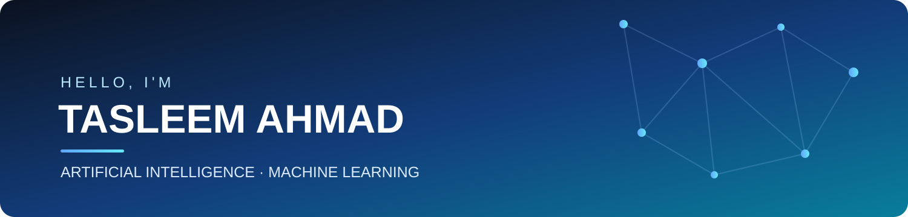

<!-- Profile README for github.com/tasleem39 -->

  
  
  

## 👨‍💻 About Me

I'm a B.E. Artificial Intelligence and Machine Learning undergraduate at **Francis Xavier Engineering College**, Tamil Nadu, India (2024–2028). I enjoy exploring how machine learning, natural language processing, and information retrieval can solve practical problems.

- 🎓 Currently pursuing **B.E. Artificial Intelligence & Machine Learning**
- 🐍 Primarily working with **Python**
- 🧠 Exploring **Machine Learning, NLP, semantic search, and knowledge graphs**
- 🔬 Research interests: **Scientific Machine Learning** and **AI for Scientific Discovery**
- 🛠️ Learning by building projects, experimenting, and improving my fundamentals

## 🧰 Tech Stack

  

## 🚀 Featured Projects

### 1. EmailForensics — Email Threat Detection

> Email-forensics prototype for inspecting suspicious email messages and producing structured analysis reports.

- Parses `.eml` files and examines email authentication signals such as SPF/DMARC and DKIM signature presence.
- Analyses received-header IP information and applies rule-based fraud scoring.
- Deployed web interface for trying the project.

**Technologies:** Python, email parsing, DNS lookups, rule-based analysis

**Links:** 📄 [Repository](https://github.com/tasleem39/EmailForensics) · ⚡ [Live Demo](https://emailforensics-murex.vercel.app/)

---

### 2. BIS-Connect — AI-Powered Indian Standards Mapping

> Smart India Hackathon 2026 team project focused on mapping tender and product requirements to relevant Indian Standards.

- Analyses tender/product requirements to identify relevant Bureau of Indian Standards and certification information.
- Uses semantic search and a knowledge-graph approach to support standards discovery.
- Team project; refer to the original repository for project history and contributor attribution.

**Technologies:** Python, FastAPI, Hugging Face, FAISS, NetworkX

**Links:** 📄 [Repository](https://github.com/tasleem39/BIS-Connect) · ⚡ [Live Demo](https://sih-project-6-osrp.onrender.com) · 🔗 [Original Team Repository](https://github.com/Raja-ML-22/SIH-PROJECT)

---

### 3. Stock Price Prediction

> Machine-learning project exploring forecasting with historical stock-market data and engineered features.

- Retrieves historical market data and prepares features for model training.
- Evaluates forecasting models using a time-aware workflow.
- Includes a deployed interface for project demonstration.

**Technologies:** Python, yfinance, Pandas, Scikit-learn

**Links:** 📄 [Repository](https://github.com/tasleem39/Stock_price_prediction) · ⚡ [Live Demo](https://stock-price-prediction-orpin-iota.vercel.app/)

---

### 4. Resume-to-Job Description Matcher

> NLP-based tool for comparing resume content with job descriptions.

- Applies text preprocessing and vector similarity to estimate relevance.
- Highlights potential skill gaps between a resume and a job description.

**Technologies:** Python, Scikit-learn, NLP

---

### 5. EcoCash — IoT Reverse Vending System

> Team project concept for encouraging recycling through a smart reverse-vending workflow.

- Evaluates recyclable materials using sensors.
- Credits a contactless smart card and supports bin-fill monitoring through a dashboard.

**Technologies:** Python, IoT, NFC/RFID, Vercel

---

## 💼 Experience

**Machine Learning Intern — Corizo Online**

- Practised training, testing, and evaluating machine-learning models with Python libraries.
- Worked with data processing, feature engineering, and model-validation workflows.
- Applied NLP techniques and heuristic rules to text-analysis tasks.

## 🔬 Research Interests

- Machine Learning and model evaluation
- Scientific Machine Learning
- Natural Language Processing
- AI for Scientific Discovery
- Semantic Search and Knowledge Representation

## 📊 Most Used Languages

## 🤝 Let's Connect

I'm interested in connecting with people working on machine learning, NLP, and research-oriented AI projects.

- 📧 **Email:** [tasleem3918@gmail.com](mailto:tasleem3918@gmail.com)
- 💼 **LinkedIn:** [linkedin.com/in/tasleem33](https://linkedin.com/in/tasleem33)
- 🧑‍💻 **GitHub:** [github.com/tasleem39](https://github.com/tasleem39)

*Thanks for visiting my profile! Feel free to explore my repositories.*

